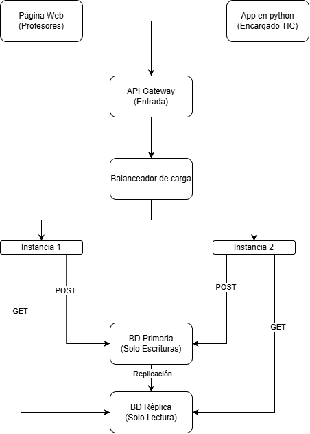
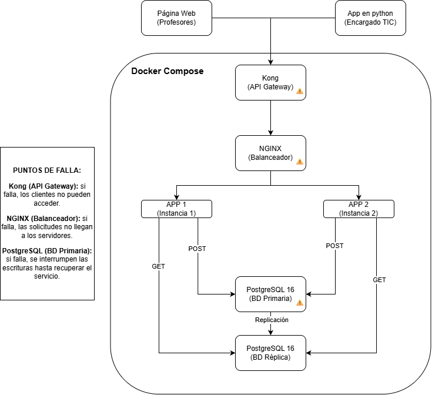

# Diseño del Sistema de Disponibilidad de Recursos TIC

## 1. Descripción del problema

En un colegio, los profesores necesitan saber si hay recursos tecnológicos disponibles, como notebooks, tablets y proyectores. Si esta información se consulta de manera informal, pueden solicitar un equipo que ya está prestado o perder tiempo preguntando al encargado.

Se propone un sistema sencillo que permita consultar la cantidad disponible de cada recurso. El encargado TIC podrá registrar cuándo se entrega o devuelve un equipo, para mantener el inventario actualizado.

## 2. ¿Quiénes lo usarán?

- **Profesores:** consultarán la disponibilidad desde una página web.
- **Encargado TIC o sistema administrativo:** consultará los datos desde un pequeño programa externo en Python y registrará entregas y devoluciones mediante la API.

Así existirán al menos dos tipos de clientes que consumen la misma API: una aplicación web y un programa externo.

## 3. ¿Por qué hay más lecturas que escrituras?

Es habitual que los profesores consulten varias veces la disponibilidad, mientras que el inventario solo cambia cuando se entrega o devuelve un equipo.

**Supuestos iniciales para un colegio:**

- 40 profesores.
- 12 consultas por profesor al día: 40 × 12 = **480 lecturas diarias**.
- 20 entregas o devoluciones al día: **20 escrituras diarias**.
- Relación lectura/escritura: 480 ÷ 20 = **24 a 1**.

## 4. ¿Cómo podría crecer?

El diseño partirá pensando en un colegio y tendrá como objetivo poder atender a **10 colegios** con un uso similar:

- Aproximadamente **400 profesores**.
- Aproximadamente **4.800 lecturas diarias**.
- Aproximadamente **200 escrituras diarias**.

Las dos instancias de la aplicación y el balanceador permitirán repartir las solicitudes y seguir respondiendo si una instancia deja de funcionar. Estos valores son una meta de diseño y se comprobarán en las siguientes fases.

## 5. ¿Qué dato es importante proteger?

El dato más importante es la **cantidad disponible de cada recurso**. Si se pierde una entrega o devolución, el sistema podría mostrar una cantidad incorrecta.

Como objetivos iniciales, se propone:

- **RPO:** perder como máximo 1 minuto de actualizaciones ante una falla grave.
- **RTO:** recuperar la capacidad de registrar cambios en un máximo de 15 minutos.
- **Lecturas:** se acepta un atraso breve de la réplica, pero antes de registrar un préstamo o devolución se verificará el valor actualizado en la base primaria.

Son objetivos de diseño; no se consideran garantizados hasta que se pruebe el sistema.

## 6. Alcance pequeño del proyecto

Para mantener el trabajo realizable, se usarán solamente **2 entidades**:

1. **Recurso:** nombre y cantidad disponible de tablets, notebooks, proyectores, etc.
2. **Movimiento:** registro de entrega o devolución, asociado al recurso.

**Endpoints principales planificados:**

- `GET /api/v1/recursos`: consultar recursos (lectura desde réplica).
- `GET /api/v1/recursos/:id`: consultar un recurso (lectura desde réplica).
- `POST /api/v1/movimientos`: registrar una entrega o devolución (escritura en primaria).
- `GET /health`: comprobar el estado de cada instancia.

**Limites**

El proyecto no incluirá autenticación de profesores, reservas anticipadas ni notificaciones, para concentrarse en la arquitectura solicitada.

# Requisitos Funcionales:
1. Consultar Recursos: Los profesores pueden ver el listado junto con la disponibilidad de los recursos dentro de la pagina web
2. Consultar 1 Recurso: Se puede revisar la disponibilidad de un recurso en especifico
3. Registrar Entrega: El encargado TIC puede registrar la entrega de 1 o más unidades de un recurso desde un programa en Python
4. Registrar Devolución: El encargado TIC puede registrar la devolución de las unidades de un recurso
5. Actualizar Disponibilidad: Al registrar una entrega o devolución el sistema actualiza la cantidad disponible
6. Evitar Cantidades Negativas: No se permite entregar una cantidad superior a la disponible, siempre se valida el dato 
7. Consultar Movimientos: El encargado puede consultar los movimientos registrados de cada recurso

La aplicación web y el programa administrativo en Python consumirán la misma API. Se mantendrán dos entidades principales: Recurso y Movimiento.

# Requisitos No Funcionales:
1. Tiempo de respuesta de lectura: El 95% de las consultas responderá en menos de 500ms en la carga estimada
2. Tiempo de respuesta de escritura: El 95% de las entregas y devoluciones se registra en menos de 1 segundo en la carga estimada
3. Disponibilidad: Al menos un 99% durante el horario de uso del colegio 
4. RPO: Ante una falla grave, perder como máximo 1 minuto de cambios recientes
5. RTO: Recuperar la capacidad de registrar movimientos en un máximo de 15 minutos
6. Escalabilidad: Atender hasta 10 colegios con 2 instancias de la aplicación y un balanceador
7. Consistencia: Las escrituras se validan contra la base primaria. La consulta desde la réplica puede mostrar brevemente datos anteriores

# Estimación de carga
1 colegio: 40 profesores
Consultas por profesor: 12 al día 
Entregas y devoluciones: 20 movimientos por día 
Horario de uso: 8 Horas diarias (Durante el periodo de clases)
Escala objetivo: 10 colegios de tamaño similar
Hora punta: Se estima una carga 5 veces mayor que el promedio durante el horario de uso
Año escolar: Aprox 200 dias de actividad

# Cálculos de lecturas y escrituras
**Un Colegio**
Lecturas al día: 40 profesores x 12 consultas = 480 lecturas por día
Escrituras al día: 20 movimientos por día
Relación: 480/20 = 24 escrituras por cada escritura (24:1)

**10 Colegios**
Lecturas al día: 480 x 10 = 4800 lecturas al día
Escrituras al día: 20 x 10 = 200 escrituras al día

**Promedio por segundo en horario de uso**
Lecturas: 4800/28800(8horas transformado a seg) = 0,167 lecturas por segundo
Escrituras: 200/28800 = 0,0069 escrituras por segundo 

**Hora punta estimada (5veces el promedio)**
Lecturas: 0,167 x 5 = 0,833 lecturas por segundo
Escrituras: 0,0069 x 5 = 0,0347 escrituras por segundo 

Estas cifras son promedios de referencia para dimensionar el sistema; las peticiones reales llegan de manera irregular y pueden concentrarse en segundos específicos.

# Estimación a 5 años
Se considera que cada movimiento registrado ocupa aproximadamente 250 bytes como supuesto inicial (incluidos sus campos y una estimación sencilla de espacio por registro)

Movimientos anuales: 200 movimientos al día x 200 días al año = 40000 movimientos al año
Movimientos en 5 años: 40000 x 5 = 200000 movimientos 
Espacio para movimientos: 200000 x 250 bytes = 50000000 bytes 
Recursos: Se estiman 20 tipos de recursos por colegio x 10 colegios = 200 registros, con un tamaño muy pequeño frente al historial de movimientos
Considerando espacio adicional para índices y crecimiento, se reserva un margen de 3 veces: aproximadamente 150 MB

Esta es una estimación de datos de la aplicación, no incluye las copias de seguridad ni el almacenamiento adicional necesario para mantener la réplica completa. La réplica tendrá su propia copia de los datos

# Resumen 
El sistema propuesto tiene más lecturas que escrituras (24:1), por lo que es razonable usar una réplica de lectura. La aplicación web y el programa administrativo justifican una entrada común mediante API Gateway. El balanceador y las dos instancias permiten distribuir solicitudes y mantener el servicio de aplicación ante la caída de una instancia.

# Diagrama Lógico y Físico

# Diagrama lógico

# Diagrama físico

# Justificación de componentes

# API GATEWAY (KONG)
Es el punto de entrada de las solicitudes de la página web y la app en python. Permite controlar el acceso y dirigir estas solicitudes hacia el balanceador
Sin el, los usuarios deberian conectarse directamente al balanceador y el control de acceso deberia de implementarse de alguna otra manera.
Requiere configurar un contenedor adicional.

# BALANCEADOR DE CARGA (NGINX)
Distribuye las cargas entre una instancia y otra evitando que caiga todo el peso sobre una sola.
Sin el, las solicitudes se enviarian solamente hacia una instancia, aumentando su carga e incrementando el riesgo de sobrecarga y aumento de latencia.
Requiere una configuración adicional y agrega un pequeño tiempo de procesamiento a cada solicitud.

# INSTANCIAS DE LA APLICACIÓN
Permite atender las solicitudes desde 2 instancias distintas que ejecutan la misma aplicación. En caso de que una falle, la otra puede seguir funcionando.
Con una sola instancia, una falla podria dejar la app sin servicio.
Se necesitan más recursos del computador, como memoria RAM y procesamiento. 

# BASE DE DATOS PRIMARIA (POSTGRESQL 16)
Almacena la información de los recursos TIC registrando entregas y devoluciones, ademas de validar la disponibilidad de estos antes de cada entrega.
Sin ella, no existiría una base de datos donde registrar estos cambios de forma centralizada.
Requiere almacenamiento, memoria y mantenimiento.

# BASE DE DATOS RÉPLICA (POSTGRESQL 16)
Mantiene una copia de los datos provenientes de la BD Primaria y permite realizar consultas sin aumentar la carga de lectura en la BD principal.
Sin ella, tanto las solicitudes de lectura y escritura serian realizadas sobre la BD Primaria, aumentado su carga de trabajo.
Necesita almacenamiento adicional y configuración para mantener los datos replicados. Además, puede existir un pequeño retraso en la actualización de la información.

# DOCKER COMPOSE
Permite organizar y ejecutar los contenedores tanto del API Gateway, como del balanceador, instancias y bd mediante una misma configuración.
Sin el se debería configurar e iniciar cada componente por separado.
Requiere aprender a configurar los contenedores y administrar los recursos del computador donde se ejecutan.

# Riesgos 

1.Caída del API Gateway o Balanceador
En caso de la caída de uno de estos servicios los usuarios no podrian acceder correctamente a la aplicacion aunque los servidores sigan activos.
Para mitigar: Se deberá supervisar el funcionamiento de los contenedores y reiniciar el componente que presente problemas. También se revisarán los registros de errores para identificar la causa de la falla.

2.Caída de la DB primaria
En caso de que esta deje de funcionar, no se podrían registrar nuevas entregas ni devoluciones, además corremos el riesgo de perder el registro de movimientos que no alcanzaron a ser replicados.
Para mitigar: Se utilizará la réplica como respaldo disponible. En caso de una falla grave, se podrá promover manualmente la réplica como nueva primaria y recuperar el funcionamiento del sistema. Después de promover la réplica, se actualizará la conexión de las aplicaciones para que puedan volver a registrar movimientos. Se buscará cumplir con el RPO de 1 minuto y el RTO de 15 minutos definidos como objetivos.

3.Retraso en la replicación de datos
La base de datos de replica puede tener retrasos en recibir los cambios realizados en la bd primaria. Esto puede provocar vistas desactualizadas de disponibilidad de recursos.
Para mitigar: Se supervisará el estado de la replicación y se validará siempre la disponibilidad en la base primaria antes de registrar una entrega, evitando prestar más recursos de los disponibles.